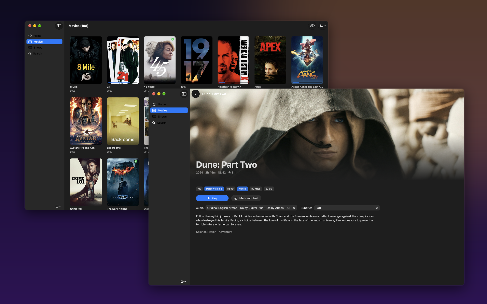
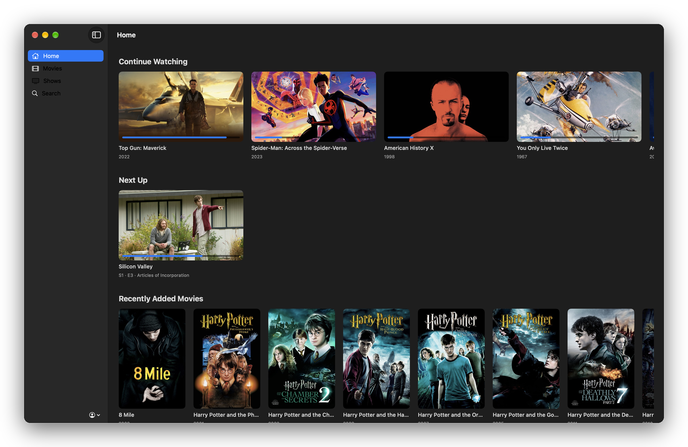
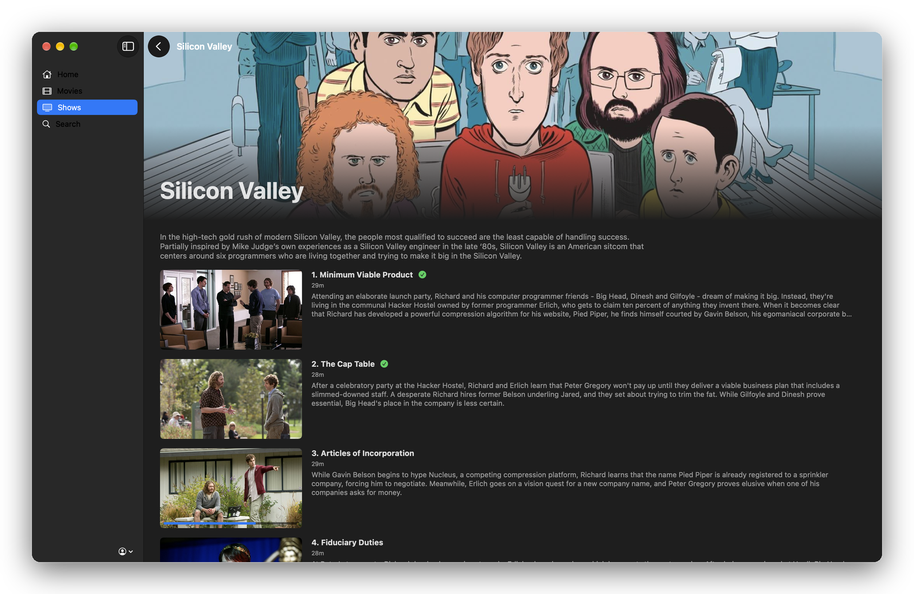

# Candela

**A Jellyfin client for macOS that plays your files directly, in real HDR, with Dolby Vision metadata and
head-tracked Spatial Audio — on the MacBook Pro's XDR display.**



Candela is a native SwiftUI library browser on top of [mpv](https://mpv.io) and
[libplacebo](https://code.videolan.org/videolan/libplacebo). It streams the original file from your
server — no transcoding, no remuxing — and renders it with a configuration tuned for Apple's HDR displays.

*The name: a nit, the unit HDR brightness is measured in, is one candela per square metre.*

| Home | Show |
|---|---|
|  |  |

> macOS screenshots are always captured in SDR, so they can't show the HDR picture itself — only the app.

## Why

On a Mac, the existing free options each give something up (my understanding as of October 2026 —
corrections welcome via an issue):

| | Real HDR on XDR | Dolby Vision metadata | Plays MKV untouched | Server load |
|---|---|---|---|---|
| Swiftfin – VLC player | ⚠️ tone-mapped | ❌ | ✅ | none |
| Swiftfin – Native player | ✅ | ✅ | ❌ remuxed to HLS; PGS subtitles force a full transcode | remux / transcode |
| Jellyfin Media Player | ⚠️ tone-mapped | ❌ | ✅ | none |
| Infuse Pro (paid) | ✅ | ✅ certified | ✅ | none |
| **Candela** | ✅ | ✅ libplacebo | ✅ | **none** |

What you get when you press Play on a 4K Dolby Vision remux:

```
Decoder format: 3840x2160 videotoolbox[p010] dolbyvision/bt.2020/pq
Picked surface configuration: A2R10G10B10 + VK_COLOR_SPACE_HDR10_ST2084_EXT
Metal layer HDR metadata changed: max nits: 1000
```

That is: hardware HEVC decoding, the Dolby Vision RPU applied by libplacebo, and a PQ (HDR10) surface handed to
macOS's EDR compositor — highlights go up to the panel's 1600 nits while SDR white stays where it is.

## Features

- **Home** — Continue Watching, Next Up, Recently Added movies and shows
- **Movies / Shows** — poster grids, sort by title, date added, year or rating, *Unwatched* filter;
  seasons and episodes for shows
- **Search** across movies, shows and episodes
- **Detail page** — quality badges (4K · Dolby Vision 8 · HDR10 · Atmos · TrueHD · DTS-HD MA · bitrate · size),
  audio and subtitle pickers, Resume / From start / Mark watched
- **Direct play** of the original file; every codec FFmpeg knows, including TrueHD, DTS-HD MA and PGS subtitles
- **Spatial Audio** — 5.1/7.1 tracks (TrueHD, DTS-HD MA, DD+ …) reach macOS as discrete channels through
  `AVSampleBufferAudioRenderer`, so AirPods get head-tracked Spatial Audio and the built-in speakers get
  virtual surround, instead of a stereo downmix
- **Remembers your language** — pick an audio language once and every film starts in it, on the
  best-quality track available in that language (Atmos > TrueHD > DTS-HD MA > …)
- **Progress sync** — position is reported to Jellyfin every 10 s, so Continue Watching matches your TV
- **LAN discovery** and a second, remote address (reverse proxy, Tailscale, …) used automatically when the
  first isn't reachable
- **Quick Connect** sign-in; the access token is kept in the macOS Keychain
- No telemetry, no accounts, nothing but your server

## Picture settings

The defaults live in [`Resources/candela.conf`](Resources/candela.conf):

- `vo=gpu-next`, `gpu-context=macvk`, `target-colorspace-hint=yes` — libplacebo over Vulkan/Metal with real HDR output
- `hwdec=videotoolbox` — hardware decoding, Dolby Vision metadata preserved
- `profile=high-quality`, `ewa_lanczossharp` up/chroma scaling, `mitchell` downscaling, debanding
- `video-sync=display-resample` — judder-free 23.976 fps on ProMotion
- `image-subs-hdr-peak=sdr` — PGS subtitles stay at SDR brightness in HDR films
- `ao=avfoundation` — multichannel audio handed to Apple's renderer for Spatial Audio (CoreAudio as fallback)

Override anything in `~/Library/Application Support/Candela/mpv/mpv.conf`. mpv's log for the last playback is
`~/Library/Application Support/Candela/mpv.log` — the first place to look if something's off.

In the player: <kbd>Space</kbd> pause · <kbd>←</kbd>/<kbd>→</kbd> 5 s · <kbd>↑</kbd>/<kbd>↓</kbd> 1 min ·
<kbd>#</kbd> audio track · <kbd>j</kbd> subtitles · <kbd>i</kbd> stats · <kbd>q</kbd> quit (position is saved).

## Install

Requirements: **Apple Silicon Mac, macOS 14 or newer, Jellyfin 10.9 or newer** (developed against Jellyfin 12.2).

1. Download `Candela-<version>-arm64.zip` from [Releases](../../releases), unzip, move **Candela** to Applications.
2. The app isn't notarized by Apple (that needs a paid developer account), so the first launch is blocked.
   Either right-click → **Open** → **Open**, or run:
   ```
   xattr -dr com.apple.quarantine /Applications/Candela.app
   ```
3. Pick your server (or let it find one on the LAN), sign in with Quick Connect or your password.
   Allow *local network* access when macOS asks.

Release builds are self-contained — mpv and its libraries are inside the app; Homebrew isn't needed.

## Build from source

```
xcode-select --install          # Command Line Tools are enough; Xcode isn't needed
brew install mpv
./build.sh                      # dev build → ~/Applications/Candela.app, uses Homebrew's mpv
./build.sh --release            # self-contained build → dist/Candela-<version>-arm64.zip
```

`scripts/bundle_mpv.py` copies mpv and its ~50 dylibs into the bundle, rewrites their install names and
re-signs them, and adds a MoltenVK driver manifest so the Vulkan loader never looks in `/opt/homebrew`.

## Limitations

- **Not certified Dolby Vision.** libplacebo implements Dolby Vision processing from the RPU; it is not
  Dolby's licensed decoder. With profile 8.1 files the difference is small, but it is not the same thing as
  Infuse or a Dolby Vision TV.
- External subtitle files (`.srt` next to the video) aren't loaded yet — embedded tracks are.
- No offline downloads, picture-in-picture, playlists or music.
- Apple Silicon only. Intel Macs and external non-HDR displays will play, but without the HDR path.
- The player is mpv's own window and on-screen controls, not a native AVKit UI.

## Licence

Candela's code is MIT — see [LICENSE](LICENSE). Release builds bundle mpv, FFmpeg and other libraries under
their own licences (mpv and FFmpeg as built here are GPL); see [THIRD_PARTY.md](THIRD_PARTY.md).
"Dolby Vision" is a trademark of Dolby Laboratories; this project is not affiliated with or endorsed by Dolby
or the Jellyfin project.
